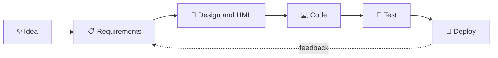

<div align="center">

<h1>Hello 👋 I'm Abdul Malik</h1>

<h3>Software Engineering Student · Python and C++ · Web and Databases</h3>

<p><i>Turning ideas into well-designed, working software.</i></p>


</div>

---

## 🧑‍💻 About Me

```js
const me = {
  name: "Abdul Malik",
  role: "Software Engineering Student",
  languages: ["Python", "C++", "Java", "JavaScript"],
  databases: ["PostgreSQL", "MySQL"],
  motto: "Understand first, design next, then code 🚀"
};
```

## ⚡ Quick Facts

- 🔭 Currently building **CreatorEarn** and a **Face Attendance System**
- 🌱 Currently learning Data Structures, Algorithms and full-stack development
- 💬 Ask me about Python, C++, databases and web projects
- 🎯 Goal: build reliable, well-designed software

## 🔄 How I Build Software



## 🛠️ Tech Stack

**Languages**


**Web**


**Databases**


**Tools**


## 🚀 Projects

| Project | What it does | Tech | Status |
|---|---|---|---|
| **CreatorEarn** | Monetization platform for content creators | Node.js | 🚧 In progress |
| **Face Attendance System** | College attendance and management using face recognition | JavaScript, face-api.js | 🚧 In progress |

## 🗺️ Learning Roadmap

- [ ] Data Structures and Algorithms
- [ ] Full-stack development
- [ ] Advanced SQL (PostgreSQL and MySQL)
- [ ] Design patterns and UML
- [ ] Open-source contributions

## 📫 Connect With Me

[](https://github.com/amalikahmed066-ops)

---

<p align="center">⭐ If you like any of my projects, feel free to give it a star!</p>
