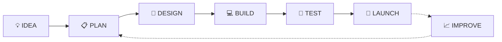

<div align="center">

# 👨‍💻 ABDUL MALIK

### `SOFTWARE ENGINEERING STUDENT` • `JAVA` • `WEB DEVELOPMENT` • `DATABASES`

<p>
  
</p>


</div>

---

# ⚡ SYSTEM.INFO

```javascript
const developer = {
    name: "Abdul Malik",
    role: "Software Engineering Student",

    currentlyBuilding: [
        "🏥 MediCare Pro",
        "🎓 Face Attendance System",
        "💻 Web Applications"
    ],

    languages: [
        "Java",
        "Python",
        "C++",
        "JavaScript"
    ],

    databases: [
        "PostgreSQL",
        "MySQL"
    ],

    motto: "Learn → Design → Build → Improve 🚀"
};
```

---

# 🚀 FEATURED PROJECTS

## 🏥 MEDICARE PRO

> **Hospital Management System**

```text
┌──────────────────────────────────────┐
│         🏥 MEDICARE PRO              │
├──────────────────────────────────────┤
│  👤 Patient Management               │
│  👨‍⚕️ Doctor Management                │
│  📅 Appointment System               │
│  📋 Medical Records                  │
│  📊 Admin Dashboard                  │
└──────────────────────────────────────┘
```

**Tech Stack**

`Java` • `OOP` • `Swing` • `PostgreSQL`

🚧 **Currently Building**

---

## 🎓 BIOATTEND PRO

> **Face Recognition Attendance System**

```text
┌──────────────────────────────────────┐
│       🎓 BIOATTEND PRO               │
├──────────────────────────────────────┤
│  👨‍🎓 Student Profiles                │
│  📷 Face Verification                │
│  📅 Attendance Tracking              │
│  👨‍🏫 Teacher Portal                  │
│  📊 University Dashboard             │
└──────────────────────────────────────┘
```

**Tech Stack**

`HTML` • `CSS` • `JavaScript` • `face-api.js`

🚧 **In Development**

---

## 💰 CREATOR EARN

> **Creator Monetization Platform**

```text
Creator → Content → Audience → Earnings 💰
```

**Tech Stack**

`Node.js` • `JavaScript` • `Databases`

🚧 **In Development**

---

# 🧬 TECH DNA

### ⚙️ Programming


### 🌐 Web


### 🗄️ Database


---

# 🗺️ DEVELOPMENT ROADMAP



---

# 📡 CURRENT MISSION

```text
[████████░░] JAVA & OOP
[███████░░░] POSTGRESQL
[████████░░] WEB DEVELOPMENT
[█████░░░░░] DATA STRUCTURES
[██████░░░░] FULL-STACK DEVELOPMENT
```

🎯 **MISSION:** Become a skilled Software Engineer and build useful, reliable software.

---

# 🛠️ TOOLKIT


---

<div align="center">

## 🌐 CONNECT

[](https://github.com/amalikahmed066-ops)

<br>

### ⚡ CODE • CREATE • INNOVATE ⚡

**⭐ If you like my projects, consider giving them a star!**

</div>
